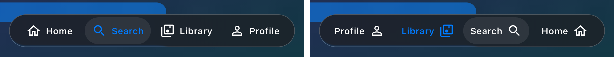
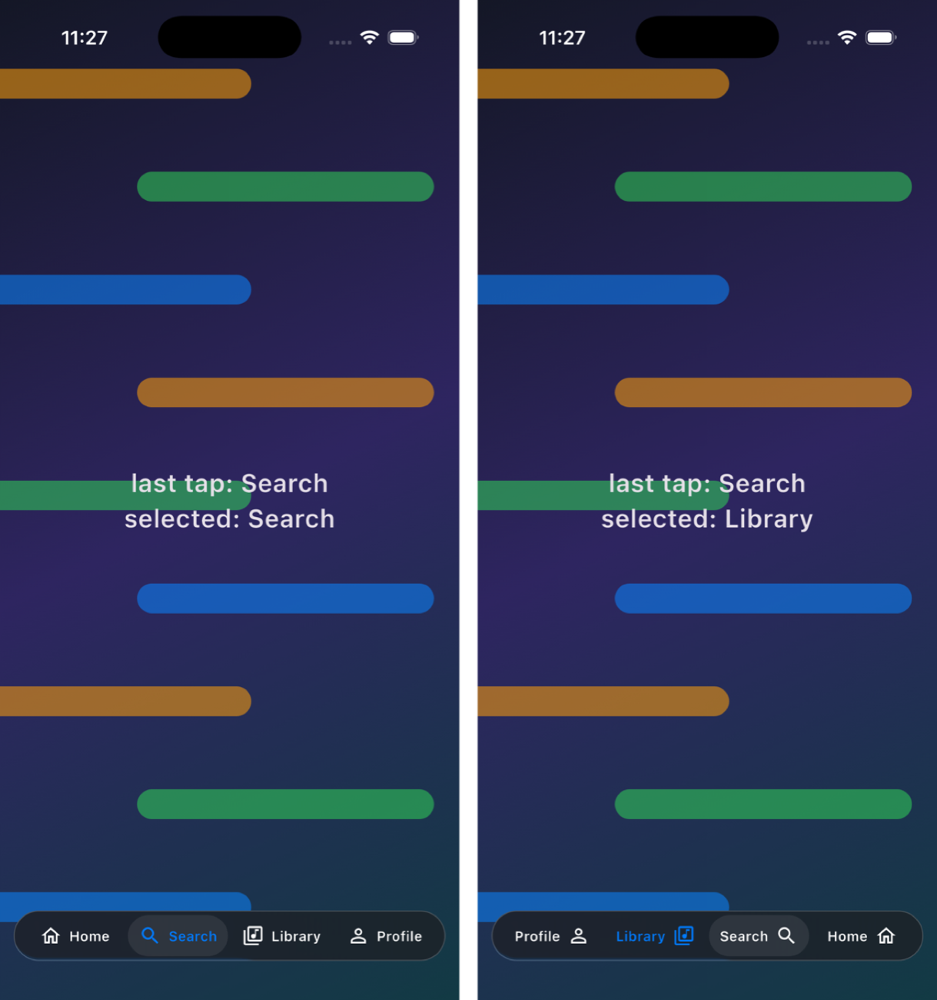
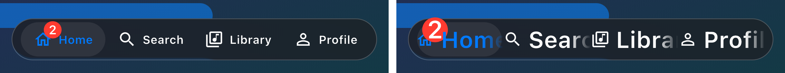
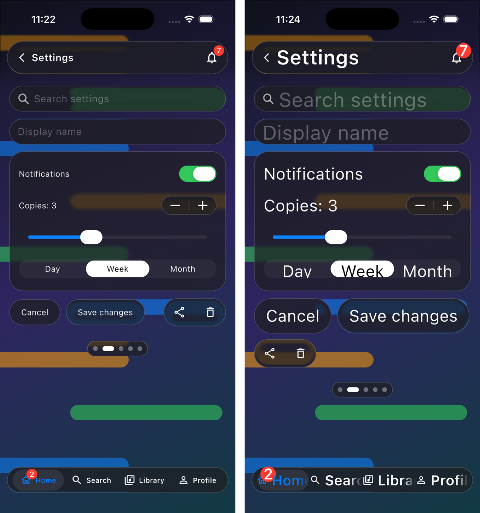
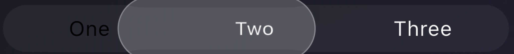
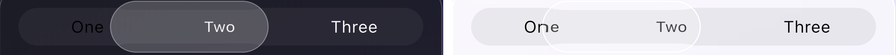

# g1455: new bugs found (not yet reported)

Found by testing g1455 on the iOS Simulator with a probe app that sets each scene up in code: it opens menus through their controllers and drives taps, holds and drags with injected pointer events, so every result is repeatable. Nothing here is filed upstream yet, and none of it touches issues #10–#16.

- **Setup:** g1455 0.2.0, Flutter 3.47.1, iPhone 17 Pro simulator, iOS 26.5, Impeller (Metal).
- **Still present upstream:** all three bugs are still in the code on `master` and on the maintainer's `release/0.3.0` branch (PR #14), checked on 2026-10-19.

| # | Bug | Severity | Fix size |
|---|---|---|---|
| 1 | Right-to-left: tapping a tab selects the mirrored tab | **High**: wrong navigation in every RTL app | Small |
| 2 | Large accessibility text: tab bar, segmented control and fields clip | **Medium**: accessibility | Medium (layout decisions) |
| 3 | Segmented control mid-drag: starting label turns black on dark glass | **Low**: transient, dark mode only | Small |

---

## 1. Right-to-left: tapping a tab selects the mirrored tab

In an RTL app (Arabic, Hebrew, Persian, Urdu…), `GlassTabBar` lays its tabs out mirrored but maps touches as if the layout were left to right. Every tap selects the tab at the opposite position.

**Tapping each visible tab** (the probe finds each label on screen and taps its centre):

| Tapped | LTR selects | RTL selects |
|---|---|---|
| Home | Home | **Profile** |
| Search | Search | **Library** |
| Library | Library | **Search** |
| Profile | Profile | **Home** |

**The last tap was "Search".** Left: LTR, "Search" is selected. Right: RTL, "Library" lights up blue while the selection pill sits behind "Search".





**Cause** (`lib/src/surface/glass_tab_bar.dart` on `master`):
- **The tab row mirrors under RTL.** The items sit in a plain `Row`.
- **Touches don't mirror.** They are mapped with `g.indexAt(e.localPosition.dx, …)` (lines 719 and 733; 728 and 748 on `release/0.3.0`).
- **The resting pill doesn't mirror.** It is placed at `left: g.centre(_at.value) - g.pill.width / 2` (line 1031; 1060 on `release/0.3.0`).

The collapse code a few lines away already handles `rtl` (lines 784 and 945). The tap and pill paths don't.

**Fix:** in RTL, map `dx` to `width - dx` before `indexAt`, and place the pill (and the held drop) at the mirrored centre. A widget test that taps each tab under `TextDirection.rtl` would pin it.

**Reproduce:**
```bash
flutter run -t docs/fix/probes/probe.dart --dart-define=SCENE=tabs --dart-define=RTL=true
```
The console prints one `PROBE tap on … → selected …` line per tab.

---

## 2. Large accessibility text: tab bar, segmented control and fields clip

At 2× text, which iOS users reach through the Larger Text accessibility setting, several controls keep fixed sizes and clip or overlap their text. g1455 has no `textScaler` handling anywhere in its source.

**Tab bar, 1× vs 2×.** Labels are cut ("Searc", "Libra", "Profil") and icons collide with the neighbouring labels:



**The whole screen, 1× vs 2×:**



**What clips at 2×:**
- **`GlassTabBar`:** labels truncate mid-word, icons overlap the next label, and the badge covers the icon.
- **`GlassSegmentedControl`:** the capsule keeps its height, so text descenders are cut ("Day").
- **`GlassSearchBar` / `GlassTextField`:** the height is fixed at `kGlassFieldHeight` (44, as the text-field docs say), so large text sits tight against the bottom edge.
- **`GlassMenuAnchor`** (minor): rows have no breathing room, icons stay small next to large text, and labels cut to one line ("Disabled action" becomes "Disable…"), where iOS menus wrap to two lines.

**What copes fine:** `GlassBar`, `GlassButton` (grows), `GlassStepper`, `GlassPageControl`, and `GlassAlert` (grows and wraps).

**Fix options:** the maintainer's call, so this one is an issue rather than a PR.
- Clamp the tab bar's and segmented control's text scale, as UIKit does for tab bars (UIKit offers the large-content viewer instead).
- Let the fields and segmented control grow with the text height.
- At large sizes, switch the tab bar to a stacked or icon-only layout.

**Reproduce:**
```bash
flutter run -t docs/fix/probes/probe.dart --dart-define=SCENE=controls --dart-define=SCALE=2
```
`SCENE=menu` and `SCENE=alert` show the menu and alert at the same scale.

---

## 3. Segmented control mid-drag: the starting label turns black on dark glass

While a finger drags the selection, the white capsule under the originally selected segment fades away as it lifts into the glass drop. That segment's label stays black, though, so on a dark control it is black on dark grey.



| Mid-drag | Text | Background | Contrast |
|---|---|---|---|
| Dark, "One" (where the drag started) | `#000000` | `#353441` | **1.73 : 1** |
| Light, "Two" (under the drop), for comparison | `#474747` | `#EFEFF3` | 8.11 : 1 |

WCAG asks for at least 4.5 : 1 for text. Light mode is fine (right half below); only dark mode breaks.



**Cause** (`lib/src/surface/glass_segmented_control.dart`):
- **The label colour is fixed at the start.** `i == widget.selectedIndex ? _onThumb(...) : ...` (line 521) gives the selected label black ink because it sits on the white capsule (line 534).
- **The capsule fades but the ink doesn't follow.** The capsule fades with `1 - lift` (line 660), and nothing follows the lift for the label.

**Fix:** blend the selected label's ink toward the normal label colour as the drop lifts: `Color.lerp(ink, ambient, lift)`. A few lines.

**Reproduce:**
```bash
flutter run -t docs/fix/probes/probe.dart --dart-define=SCENE=drag
```
The probe holds the drag for about 9 s.

---

## Checked and working (no bug)

- **Stepper hold-to-repeat:** holding plus for 3 s gives 26 steps, exactly the documented 500 ms delay then every 100 ms, in LTR and RTL. Step times (ms): 36, 539, 642, 744, … 2942.
- **RTL mirroring of the other controls:** switch, slider, segmented control, stepper (`+ | −` like UIStepper), page control, search bar, text field, badges.
- **Menus and popovers:** grow from their anchor, mirror correctly in RTL, and show disabled and destructive rows correctly.
- **Alerts:** two actions sit side by side, three stack, and the alert grows cleanly at 2× text.
- **Previously noticed:** the tab badge overlapping inline labels is in `docs/candidates/` (f05). It is not repeated here.

## Files

- `probes/probe.dart`: the probe app. `SCENE` is `controls`, `menu`, `popover`, `alert`, `stepper`, `drag` or `tabs`; `RTL=true`, `SCALE=<factor>` and `LIGHT=true` vary the scene.
- `shots/`: every simulator screenshot. The `01-…`, `02-…` and `03-…` files are the evidence above; the rest are the raw captures they came from.
